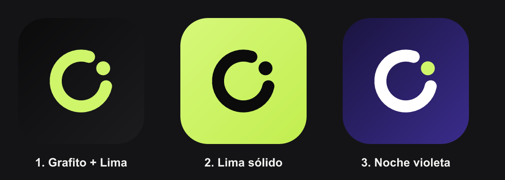

# Tinzit0

Mi app personal para organizar el día: tareas, gym, gastos (CLP), notas, hábitos, metas de ahorro, estadísticas y un asistente de voz que habla en chileno. Todo se guarda solo en el celular.

## Probar rápido con Expo Go (sin voz ni widget)

1. Instala **Expo Go** desde la Play Store.
2. En la carpeta del proyecto: `npm install` y luego `npx expo start`.
3. Celular y computador en la misma WiFi → escanea el QR con Expo Go.
   Si no conecta: `npx expo start --tunnel`.

## Development build (con voz y widget)

La voz (`expo-speech-recognition`) y el widget usan código nativo que **no viene en Expo Go**. Por eso se compila una versión propia de la app (un APK), una sola vez:

1. Crea una cuenta gratis en https://expo.dev
2. `npm install -g eas-cli` y luego `eas login`
3. `eas build --profile development --platform android`
   (la compilación es en la nube y se demora unos 10–20 minutos)
4. Al terminar, abre el enlace en el celular, descarga el APK e instálalo
   (Android te pedirá permitir "instalar apps desconocidas").
5. En el computador: `npx expo start --dev-client` y abre **Tinzit0** en el celular (no Expo Go).

Desde ahí, los cambios de código se ven al tiro igual que en Expo Go. Solo hay que volver al paso 3 si se agrega una librería nativa nueva.

## Comandos útiles

- `npm test` — pruebas de base de datos y del asistente
- `npx tsc --noEmit` — revisar tipos
- `node scripts/generar-iconos.mjs lima <carpeta-resvg>` — cambiar el estilo del ícono
